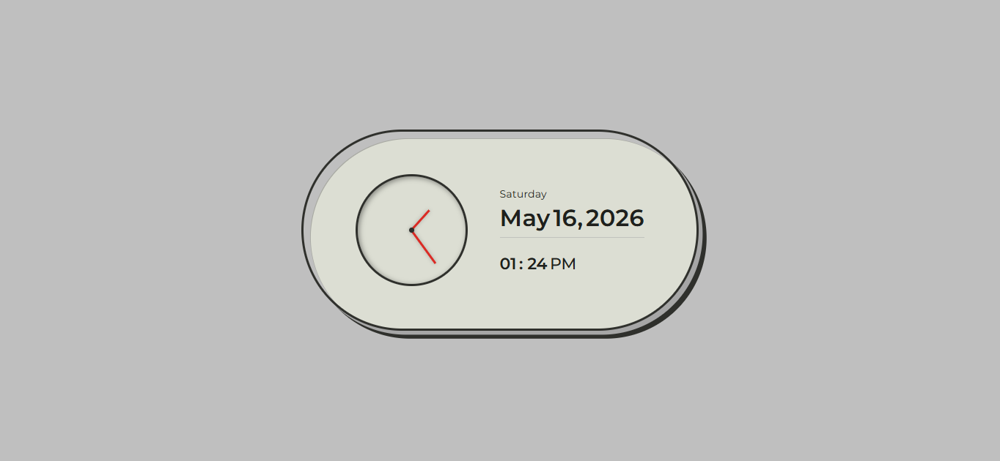

# Retro Clock

A retro-inspired analog clock made with **HTML, CSS, and vanilla JavaScript**. The clock reads the browser’s local time and updates the hour and minute hands as time changes.

## Features

- Analog hour and minute hands
- Updates from the current local time
- CSS-styled retro clock face
- Lightweight, dependency-free page

## Run locally

Open `RetroClockDesign/index.html` in a browser. Keep the `RetroClockDesign/assets/` folder next to the page.

## Built with

- HTML5
- CSS3
- Vanilla JavaScript
